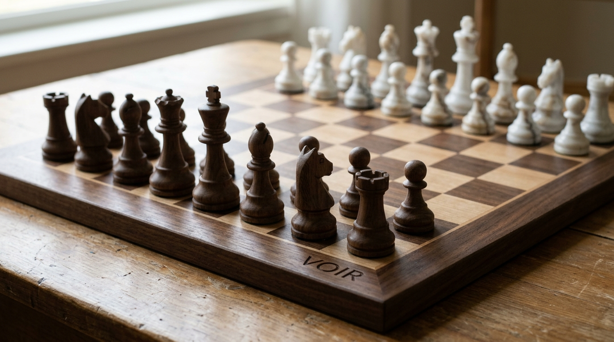

# Voir

*Voir* is French for **to see**. It is a chess game about seeing who you can become.

You sit at a walnut chessboard as the white marble king. Across the table sits **your future self**, playing the pieces life threw at them: burnout, self-doubt, failed exams, setbacks. Every square is something you could become. Every move is a year you will not get back.



## How to play

1. **Pick a dream.** Doctor, inventor, engineer, entrepreneur, creative or changemaker. Each career has 8 levels (the ranks of the board) and 8 directions (the files), plus great minds you can meet on the way.
2. **Say where you are.** Your age, your current level, the direction that pulls you most, how far you want to go and by what age.
3. **Answer five questions.** Your personality (discipline, curiosity, resilience, empathy, boldness) changes your odds and gives you a signature piece.
4. **Play.** Each turn is one year. Choose how you move:

| Piece | Way of living | Move |
| --- | --- | --- |
| ♟ Pawn | Patience | One square forward |
| ♚ King | Care | One square in any direction except back |
| ♜ Rook | Focus | Straight forward or sideways, any distance |
| ♝ Bishop | Vision | Diagonally forward, any distance |
| ♞ Knight | Leap | The L-shaped jump, over anything |
| ♛ Queen | Freedom | Any line, once per life |

Pick a lit square to see your odds, what happens if it works and what happens if it fails. Then play the move. **There is no going back.**

## The rules of life

- You can never move backwards in time, unless you are in check.
- Like a king in chess, you can never step onto a square an obstacle attacks.
- Life replies after every move. Obstacles can put you in check, and if no safe move is left, it is checkmate.
- A failed move keeps you where you are and costs the year. Run out of energy and burnout costs another year.
- The game ends when you reach your goal, run out of time, or get trapped.

## How the odds work

Each square holds an event (study, work, people, rest, impact, risk or a great mind). Your chance of success is:

- the event's base chance,
- plus your matching personality trait,
- plus your energy,
- minus a penalty for climbing more than one level at once,
- minus a penalty if your skill is behind the level you aim for,
- plus a bonus when you move with your signature piece.

Odds are always between 5% and 97%. The **Possibilities** panel counts every path still open to you, the squares you can still reach and the fastest route to your goal.

## The 3D table

The game opens on a 3D table built with [three.js](https://threejs.org/). You see yourself and your future self facing each other across the board. Future you moves life's pieces by hand and talks to you as you play. Use the **Table**, **Your seat** and **Above** views, or drag to walk around the table.

If the device has no WebGL or is offline, Voir falls back to the flat board automatically. The **3D table** button switches between the two.

## Run it

Open `index.html` in a browser. Music and sound start when you press **Begin**.

## Test it

Requires [Node.js](https://nodejs.org/) 18 or newer.

```bash
npm install
npm test
```

The tests load the real page in jsdom and play it through the DOM: setup, chess rules, check and checkmate, odds, possibilities, replay, sound toggles and 120 random full games across every career.

